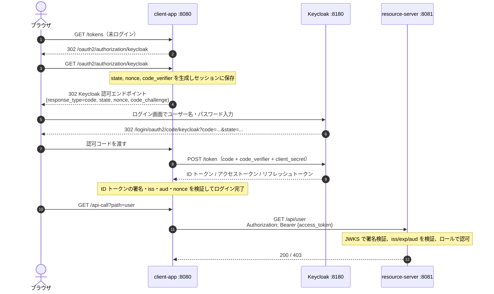

# OAuth2 / OIDC 学習用サンプル（Spring Security × Keycloak）

Spring Security と Keycloak を使って、OAuth 2.0 / OpenID Connect の主要な登場人物とフローを手元で動かしながら学ぶためのサンプルです。

| 構成要素 | 役割（OAuth2 用語） | ポート |
|---|---|---|
| Keycloak | Authorization Server（認可サーバー）/ OpenID Provider | 8180 |
| `client-app` | Client（OAuth2 Client / OIDC Relying Party） | 8080 |
| `resource-server` | Resource Server（アクセストークンで保護された API） | 8081 |
| ブラウザ利用者（alice / bob） | Resource Owner | - |

## 学べること

- **Authorization Code Grant + PKCE**（`client-app` のログイン）
- **OIDC**：ID トークン、UserInfo、RP-Initiated Logout
- **Client Credentials Grant**（ユーザーなしのサーバー間通信）
- **Resource Server での JWT 検証**：署名（JWKS）、`iss`、`exp`、`aud`
- **認可**：Keycloak の realm ロール（`realm_access.roles`）を Spring Security の `ROLE_xxx` に変換し、401 / 403 の違いを確認
- **リフレッシュトークン**による自動更新（アクセストークンの寿命は 5 分）

## 動作環境

- Java 21 以上（ビルドは同梱の Gradle Wrapper を使用）
- Docker（Keycloak 用）

確認時のバージョン：Spring Boot 4.1.2（Spring Security 7）、Gradle 9.9.1、Keycloak 26.8.2（2026-11 時点）

テストのみ実行する場合：`./gradlew test`

## 起動手順

```bash
# 1. Keycloak を起動（realm・クライアント・ユーザーは自動インポート）
docker compose up -d

# 2. Resource Server を起動（別ターミナル）
./gradlew :resource-server:bootRun

# 3. Client アプリを起動（別ターミナル）
./gradlew :client-app:bootRun
```

両アプリは起動時に Keycloak の Discovery エンドポイントへ接続するため、**Keycloak を先に起動**してください。

ブラウザで http://localhost:8080 を開き、「Keycloak でログイン」を押します。

| ユーザー | パスワード | realm ロール |
|---|---|---|
| alice | alice | user |
| bob | bob | user, admin |

Keycloak 管理コンソール：http://localhost:8180/admin （admin / admin）

## 期待される結果

| 操作 | alice | bob |
|---|---|---|
| `/api/public` | 200 | 200 |
| `/api/user`（ユーザーのトークン） | 200 | 200 |
| `/api/admin`（ユーザーのトークン） | **403** | 200 |
| `/api/user`（Client Credentials） | 200 | 200 |

トークンなしで `curl http://localhost:8081/api/user` すると **401** になります。

## フロー

### Authorization Code Grant + PKCE（ログイン）



### Client Credentials Grant

```bash
# トークン取得（batch-client 自身として）
curl -s -u batch-client:batch-client-secret \
  -d grant_type=client_credentials \
  http://localhost:8180/realms/oauth2-sample/protocol/openid-connect/token
```

```bash
# 取得した access_token で API を呼ぶ
curl -H "Authorization: Bearer <access_token>" http://localhost:8081/api/user
```

`client-app` では `/api-call?path=user&registration=batch` が同じことを Spring Security の `OAuth2AuthorizedClientManager` 経由で行います。

## コードの読みどころ

| ファイル | ポイント |
|---|---|
| [`client-app/.../SecurityConfig.java`](client-app/src/main/java/com/example/client/SecurityConfig.java) | `oauth2Login()`、PKCE 有効化、OIDC ログアウト |
| [`client-app/.../RestClientConfig.java`](client-app/src/main/java/com/example/client/RestClientConfig.java) | `OAuth2AuthorizedClientManager`（refresh / client_credentials）と、Bearer トークンを自動付与する `OAuth2ClientHttpRequestInterceptor` |
| [`client-app/.../HomeController.java`](client-app/src/main/java/com/example/client/HomeController.java) | ID トークン・アクセストークンの中身を表示 |
| [`client-app/.../application.yml`](client-app/src/main/resources/application.yml) | クライアント登録（`issuer-uri` による Discovery） |
| [`resource-server/.../SecurityConfig.java`](resource-server/src/main/java/com/example/resource/SecurityConfig.java) | `oauth2ResourceServer().jwt()`、Keycloak ロール → `ROLE_xxx` 変換 |
| [`resource-server/.../application.yml`](resource-server/src/main/resources/application.yml) | `issuer-uri` と `audiences` による検証 |
| [`resource-server/.../ApiControllerTest.java`](resource-server/src/test/java/com/example/resource/ApiControllerTest.java) | Keycloak なしで認可ルールをテスト |
| [`keycloak/realm-oauth2-sample.json`](keycloak/realm-oauth2-sample.json) | realm、クライアント、ユーザー、Audience マッパー |

## 発展課題

1. `client-app` の `logging.level.org.springframework.security` を `TRACE` にして、リダイレクトとトークン交換の流れをログで追う
2. Keycloak の Audience マッパーを外し、`aud` 検証で 401 になることを確かめる
3. Keycloak 管理画面で alice に `admin` ロールを付与し、再ログイン後に `/api/admin` が 200 になることを確かめる
4. `@PreAuthorize("hasRole('admin')")` によるメソッドセキュリティに書き換える
5. Keycloak のクライアントスコープ（例：`sample-api.read`）を作り、ロールではなく `SCOPE_xxx` で認可する

## 注意

学習用の設定です。クライアントシークレットや管理者パスワードの直書き、`start-dev`（HTTP / 組み込み DB）、トークンの画面表示は本番では行わないでください。

## 参考

- Spring Security OAuth2 Client: https://docs.spring.io/spring-security/reference/servlet/oauth2/client/index.html
- Spring Security OAuth2 Login: https://docs.spring.io/spring-security/reference/servlet/oauth2/login/index.html
- Spring Security Resource Server (JWT): https://docs.spring.io/spring-security/reference/servlet/oauth2/resource-server/jwt.html
- Keycloak Server Administration Guide: https://www.keycloak.org/docs/latest/server_admin/
- Keycloak を Docker で起動: https://www.keycloak.org/getting-started/getting-started-docker
- RFC 6749 (OAuth 2.0): https://www.rfc-editor.org/rfc/rfc6749
- RFC 7636 (PKCE): https://www.rfc-editor.org/rfc/rfc7636
- OpenID Connect Core 1.0: https://openid.net/specs/openid-connect-core-1_0.html
